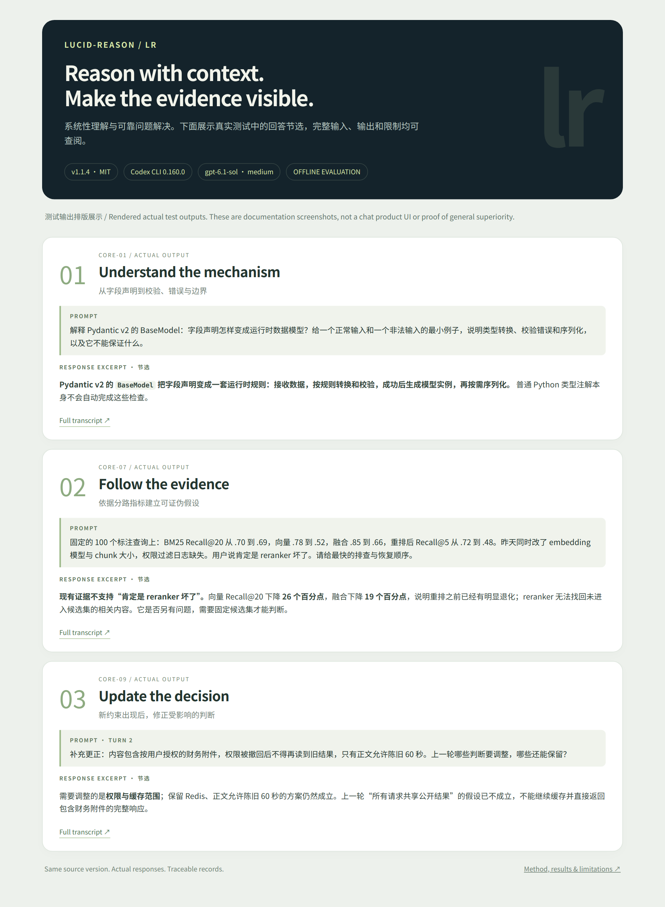

<p align="center"></p>

<p align="center">
  <a href="LICENSE"></a>
  <a href="https://github.com/aikuozone/lucid-reason/actions/workflows/ci.yml"></a>
  <a href="https://github.com/aikuozone/lucid-reason/releases"></a>
</p>

<p align="center"><a href="README.zh-CN.md">简体中文</a> · <a href="docs/installation.md">Installation</a> · <a href="examples/README.md">Real examples</a> · <a href="evals/REPORT.md">Evaluation evidence</a></p>

**lucid-reason (`lr`) is an instruction-only skill for understanding concepts, making engineering decisions, and diagnosing problems with evidence.** It connects the necessary concepts, mechanisms, causal relationships, constraints, and verification steps for the task at hand.

Use it when a definition is insufficient, a design needs to respect an existing project, or a diagnosis needs hypotheses that can actually be checked. Output length and format follow the question; no fixed essay template is required.

## Try it

Clone this repository and install the complete skill into a project:

```bash
git clone https://github.com/aikuozone/lucid-reason.git
cd lucid-reason
python3 scripts/install_skill.py --target /absolute/path/to/your/project/.agents/skills
```

Start a new Codex session in that project and explicitly select the skill:

```text
$systematic-knowledge-construction Explain how BaseModel participates in an Agent tool call, including authorization, execution, and result confirmation.
```

`lr` and `lucid-reason` are natural-language discovery hints. The stable skill selector is `$systematic-knowledge-construction`; automatic selection depends on the host. See [tested installation paths and removal instructions](docs/installation.md).

## What it helps with

| Task | What the skill asks the model to do |
|---|---|
| Concept learning | Explain purpose, mechanism, nearby concepts, examples, and necessary boundaries. |
| Engineering decisions | Preserve the current project baseline; justify changes from real gaps and constraints. |
| Troubleshooting | Separate observations from hypotheses; identify evidence that can disprove a diagnosis. |
| Research and explanations | Distinguish facts, derivations, estimates, simulations, and unverified claims. |
| Follow-up questions | Carry forward available assumptions and revise affected conclusions when evidence changes. |

These are behavioral instructions, not guarantees of correct answers. The host provides the model, tools, permissions, and available conversation context. The skill adds no server, credentials, permanent memory, or external connections.

## See the behavior

The [examples](examples/README.md) show actual responses from local Codex runs, with prompts, environment information, and full transcripts. The images are explicitly labeled renderings of test outputs, rather than screenshots of a chat product.

<a href="examples/README.md"></a>

## Test and reproduce

Python 3.10+ is required for maintenance scripts. Installation and runtime packaging use only the Python standard library; offline metadata checks also use PyYAML.

```bash
python3 -m pip install -r requirements-dev.txt
python3 scripts/validate_project.py
python3 -m unittest discover -s tests -v
python3 scripts/build_release.py
```

Behavioral evaluation additionally requires a separately installed, authenticated Codex CLI:

```bash
python3 scripts/run_evaluation.py --model gpt-6.1-sol --workers 3 --run-id my-evaluation
```

This command uses your local CLI account and its usage allowance. It runs 22 scenarios with and without the installed skill, including native multi-turn sessions. Do not place account credentials in public CI. Read the [methodology, grading rules, and limitations](docs/evaluation.md) and the [observed results](evals/REPORT.md) before interpreting the evidence.

The original 16 scenarios are specification-derived. Six additional transfer scenarios were written for this release; they are not an independent sealed benchmark. There is no claim of a universal quality improvement or a verified reduction in hallucinations.

An observed gap is retained in the report: the English diagnosis answer in both conditions omitted explicit rollback triggers required by the rubric. Passing packaging checks does not erase this response-quality limitation.

## Package and compatibility

The runtime ZIP contains `plugin.json`, the optional `.codex-plugin/plugin.json` compatibility manifest, `skills/`, `LICENSE`, and a short distribution guide. Source archives include documentation, tests, and evaluation records.

The user-facing name is **lucid-reason**. The existing plugin identifier `systematic-knowledge-architect` and skill identifier `systematic-knowledge-construction` are preserved. The instruction files are authored in Chinese; the evaluation includes one English transfer case. See the [installation compatibility table](docs/installation.md) for tested and untested host paths.

## Contribute

Bring a reproducible example of a wrong conclusion, missed constraint, or unhelpful explanation. Include the model, host, skill version, prompt, and observed response. See [CONTRIBUTING.md](CONTRIBUTING.md), [CHANGELOG.md](CHANGELOG.md), and [source provenance](docs/provenance.json).

MIT licensed. Copyright © 2026 blunt. Third-party host software and models have their own terms.
