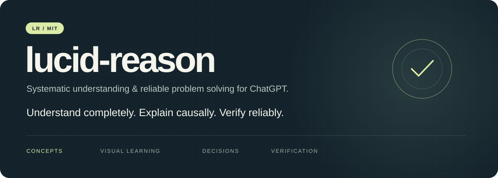
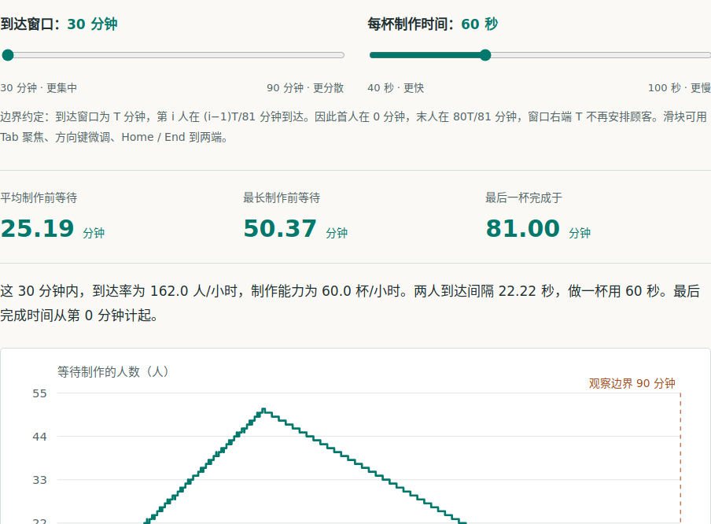

<p align="center"></p>

<p align="center"><a href="README.md">English</a> · <a href="examples/README.md">使用效果展示</a> · <a href="docs/installation.md">使用与安装</a> · <a href="evals/UPDATE-1.1.5.md">更新验证</a> · <a href="https://github.com/aikuozone/lucid-reason/releases/tag/v1.1.5">v1.1.5</a> · <a href="LICENSE">MIT</a></p>

**让 AI 系统地理解你的想法，让你清楚理解方案，在持续讨论中形成一致的整体认识。**

**lucid-reason（简称 `lr`）** 是一个基于 Skills 的系统性理解与可靠问题解决插件，适用于知识学习、计划制定、方案讨论、工程设计、研究与故障诊断。它帮助 AI 把你的问题和想法放回目标、约束与关联之中分析，再把机制、依据、取舍和方案组织成容易理解、判断与继续修改的回答。

推荐在 **ChatGPT Chat 模式**中体验知识讲解：将文字解释与当前可用的图示、公式、图表或交互组件连接起来，理解结构、计算与变量关系。制定计划和讨论方案时，lr 同样关注整体：一个局部想法会影响哪些环节，方案为什么这样安排，后续修改又会改变什么。

核心理念是**必要范围内的完整理解，以及可以持续深入的共同讨论**。局部概念可以用几个自然段讲清，复杂方案需要建立完整主干。直接用自然语言提出想法、疑问或不满意之处即可，无需手动编排工作流或部署额外服务。

## 看 lr 把原因讲清，再把方案一起改好

**平均产能够用，为什么高峰仍然排队？** 我们自行设计了一家虚构咖啡店的全新案例，用 lr 连续运行三轮：先用可操作的图文解释机制，再根据两次反馈修订完整方案。

| 看什么 | 具体发生什么 |
|---|---|
| 图文与交互一起建立理解 | 保持同样 81 位顾客，改变到达节奏或制作速度，对照解释、排队曲线与等待指标，亲眼看见积压如何形成。 |
| 完整方案在讨论中改进 | 先补充“不加人、不买设备”，再提出“不排除非手机顾客”，观察方案如何吸收约束、明确公平的时间口径，并保留撤回办法。 |

**[打开可交互展示页](https://aikuozone.github.io/lucid-reason/)** · [完整三轮对话](examples/queue-lab/conversation.md) · [截图、录屏与复现说明](examples/queue-lab/README.md)

<a href="https://aikuozone.github.io/lucid-reason/demos/queue-lab/"></a>

*lr 1.1.5 在 Codex 中使用 gpt-6.1-sol 实际生成，截图来自浏览器运行。案例为教学模拟；交互页面是实际生成的产物，不是 ChatGPT 原生界面截图，也不是门店实测成效。*

## 为什么使用 lr

1. **把内容与图表连成一次讲解。** 复杂主题的难点常在关系和中间过程：读完文字，仍不容易看出模块怎样连接、公式怎样变化、图表说明了什么。lr 按理解依赖组织内容，在有解释价值时结合 ChatGPT Chat 模式的原生图示、数学表达、图表与可用交互能力，并解释这些呈现与正文的关系。从整体结构走到关键机制，再用例子、计算和边界检查理解。

2. **理解一个想法对整个系统意味着什么。** “增加一个组件”或“换一种做法”通常只是你提出的实现设想。lr 会先厘清想达到的结果、已有能力和现实约束，再检查上下游依赖、横向关联及端到端后果。例如，提出统一 Agent 框架，实际要解决的可能是重复填字段和切换页面；需要分析的是整个使用流程如何改善，以及新增框架是否带来足够的价值。

3. **先形成完整初案，让讨论有共同基础。** 制订计划时，第一版方案的价值是把目标、主要流程、职责、取舍、异常和验收连接起来，让你看见全貌。即使它还没有符合你的全部期待，你也能指出究竟哪里不合适、遗漏了什么，以及自己更重视什么。一个可理解、可检查的完整初案，可以成为发现新想法和解决办法的起点。

4. **在持续修改中保持整体一致。** 你提出新重点、否定某一步或要求只改一个部分时，lr 会承接仍有效的目标和已确认内容，检查本次修改会影响哪些依赖，再调整相关方案。理解整体与修改整体有不同的范围；未受影响的部分保持稳定，核心约束确实冲突时则解释为什么需要更大调整。随着问题被讲清，讨论逐步收敛到双方都能理解的当前方案。

5. **把判断依据讲清楚，让你能够参与决策。** lr 解释选择的原因、可行条件、收益、代价与验证方式，区分事实、推导、估算和未知。你可以据此质疑假设、比较取舍或改变方向。达成共识依赖把分歧和依据说清楚；如果某个建议违反目标或约束，lr 应说明问题并提出可以继续讨论的替代办法。

这些是对模型理解、分析与表达方式的指导，实际效果仍取决于模型和任务。技能由指令与参考文件组成；模型、工具、界面、权限和可用上下文由宿主提供。图表渲染及永久记忆也不由技能单独实现。

## 怎样用它讨论计划与方案

可以从一个还不成熟的想法开始，不必先把完整需求和架构都写好。下面是一种讨论方式：

| 讨论阶段 | 你可以这样说 | 讨论希望得到什么 |
|---|---|---|
| 建立完整初案 | “我有工单和检索两个工具，想让员工少切换页面，考虑做一个统一 Agent。先理解目标，给出可讨论的整体方案。” | 真实目标、现状、完整流程、必要改动、取舍与验收之间的联系。 |
| 指出不满意之处 | “我真正关心的是不用重复填字段。保留这两个工具和原有权限，修改相关流程。” | 修正重点、检查依赖，说明改动的影响及继续成立的结论。 |
| 收敛当前共识 | “整理当前方案、选择依据、还没确定的假设和下一步验证，再据此制订实施计划。” | 一份双方容易理解、能够继续验证和推进的共同方案。 |

初案帮助暴露分歧，追问帮助深化理解，修改帮助形成更合适的办法。[三轮真实方案讨论记录](examples/planning.md)展示了这种用法；更一般的概念学习、技术决策和排障也可以采用自然追问。

## 在 ChatGPT Chat 模式中使用

如果你的账号或工作区已经可以使用 lucid-reason，在 Chat 对话输入框输入 **`@`**，从选择器中选中 lucid-reason 或其技能，再自然描述问题。`lr` 是便于表达使用意图的简称；显式选择可以明确指定要使用的技能。

```text
lr 解释为什么平均产能足够，高峰时仍然排队。

lr 保持同样一批顾客。如果界面支持，让我调节到达节奏和制作速度，观察等待怎样变化。

lr 帮我分析这个想法对整个系统意味着什么，先给一份依据清楚、可讨论的完整方案。

lr 沿用前面的目标和约束，只修改我们刚讨论的部分，解释关联影响。
```

也可以继续追问：“为什么需要这一步？”“展示等待时间怎样一步步累积。”“沿用前面的架构，只深入解释权限校验。”

图表和交互能力取决于当次客户端与可用工具。相关宿主说明见 OpenAI 的[技能文档](https://learn.chatgpt.com/docs/build-skills)与[可视化文档](https://learn.chatgpt.com/docs/visualizations)。本仓库提供源码和运行包，GitHub 开源发布本身不会将插件加入 ChatGPT 公共目录。接入条件见[使用与安装说明](docs/installation.md)。

## 在 Codex 中使用相同技能

也可以把完整技能安装到项目中。这条路径同时用于可复现的文本行为评估。

```bash
git clone https://github.com/aikuozone/lucid-reason.git
cd lucid-reason
python3 scripts/install_skill.py --target /你的项目绝对路径/.agents/skills
```

在目标项目中新开 Codex 会话，显式调用：

```text
$systematic-knowledge-construction 解释 BaseModel 如何参与 Agent 工具调用，覆盖参数校验、业务授权、执行和结果确认。
```

已测路径、发行包安装和移除方法见[安装说明](docs/installation.md)。上面的展示明确记录了运行宿主，并保留实际生成的交互讲解页面。

## 测试与复现

维护脚本需要 Python 3.10+。安装和打包使用标准库；离线配置校验另外需要 PyYAML。

```bash
python3 -m pip install -r requirements-dev.txt
python3 scripts/validate_project.py
python3 -m unittest discover -s tests -v
python3 scripts/build_release.py
```

[v1.1.5 更新验证](evals/UPDATE-1.1.5.md)单独记录本次更新的针对性回归。[v1.1.4 历史报告](evals/REPORT.md)保留了旧版 22 个场景下的 68 次已完成本地会话，包含成对运行及部分重复运行，并保留实际发现的缺口。历史记录对应的源文件已经冻结，不能作为新版已通过相同评估的证明。

[评估方法与复现命令](docs/evaluation.md)、[历史 CLI 案例](examples/cli.md)、[展示素材来源与复现方式](docs/presentation.md)分别记录不同证据。真实回答观察与评分不代表普遍质量提升；新案例记录了模型、技能版本、完整回答、原始交互产物及浏览器检查，没有无技能对照。

## 分发与贡献

运行包包含 Manifest、完整技能、MIT 许可和分发说明。展示名为 **lucid-reason**，保留插件标识 `systematic-knowledge-architect` 和技能标识 `systematic-knowledge-construction`。技能正文使用中文，测试包含一个英文迁移场景。

欢迎提交可以复现的错误结论、遗漏约束或解释问题，附上宿主、模型、版本、输入与实际回答。详见[贡献指南](CONTRIBUTING.md)、[更新记录](CHANGELOG.md)与[来源记录](docs/provenance.json)。

**Understand completely. Explain causally. Decide carefully. Verify reliably.**

MIT 许可，Copyright © 2026 blunt。
