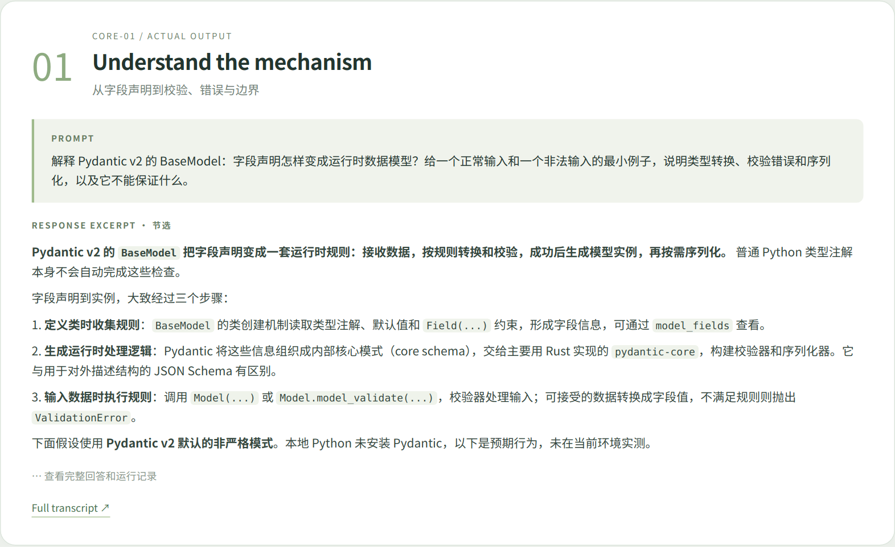
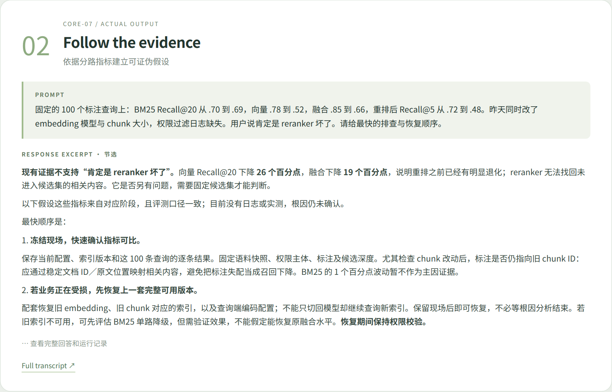
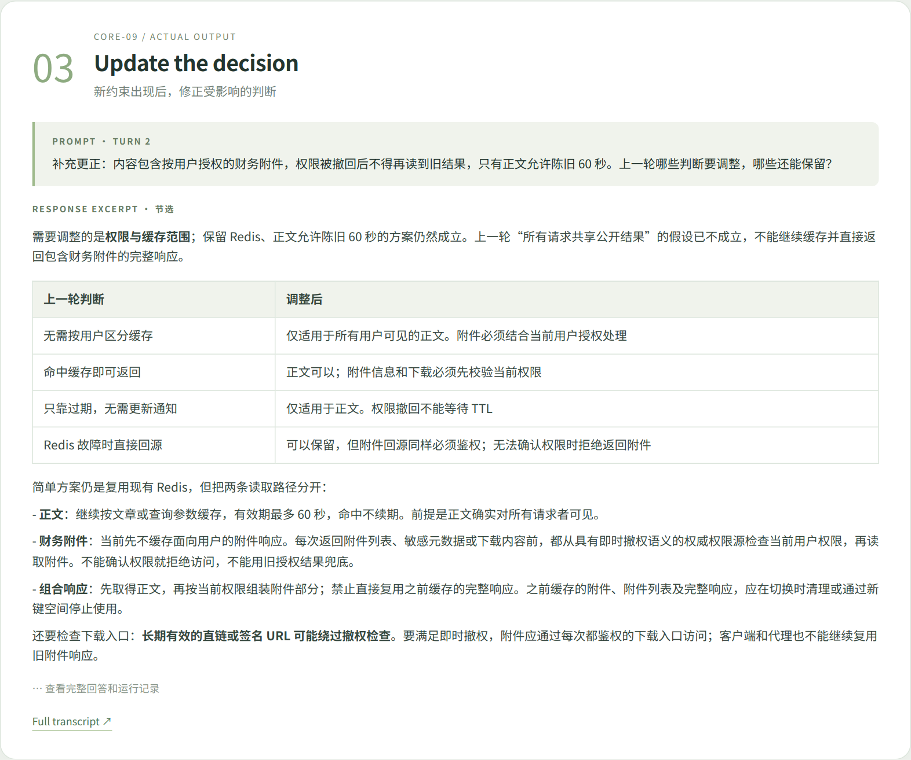

# Actual examples

These examples use actual final responses from native Codex CLI evaluations. The images are renderings of those outputs, labeled as excerpts. They are not product UI screenshots or independent proof of an improvement.

Environment: Codex CLI 0.160.0; requested model `gpt-6.1-sol`; reasoning effort `medium`; offline tools; source v1.1.4. Full inputs, tool trace summaries, and limitations are in the linked JSON records.

## Concepts: mechanism, examples, boundaries

[Full conversation](concept.md) · [Run record](../evals/results/release-v1.1.4/core-01-lr-r1.json)

## Diagnosis: observations, hypotheses, verification

[Full conversation](diagnosis.md) · [Run record](../evals/results/release-v1.1.4/core-07-lr-r1.json)

## Follow-up: preserve context, update the decision

[Full conversation](continuity.md) · [Run record](../evals/results/release-v1.1.4/core-09-lr-r1.json)

## Independent forward task

A fresh agent received only the skill location and a realistic campus research-assistant request. It produced a constrained pilot proposal in an isolated temporary directory. This is an additional forward example, outside the paired benchmark counts.

[Task](../evals/forward-test/input.md) · [Actual answer](../evals/forward-test/answer.md) · [Execution limits](../evals/forward-test/metadata.json)

[Presentation provenance and regeneration](../docs/presentation.md) · [Observed evaluation results](../evals/REPORT.md)
