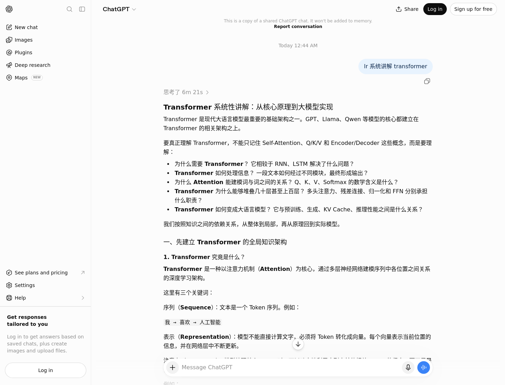
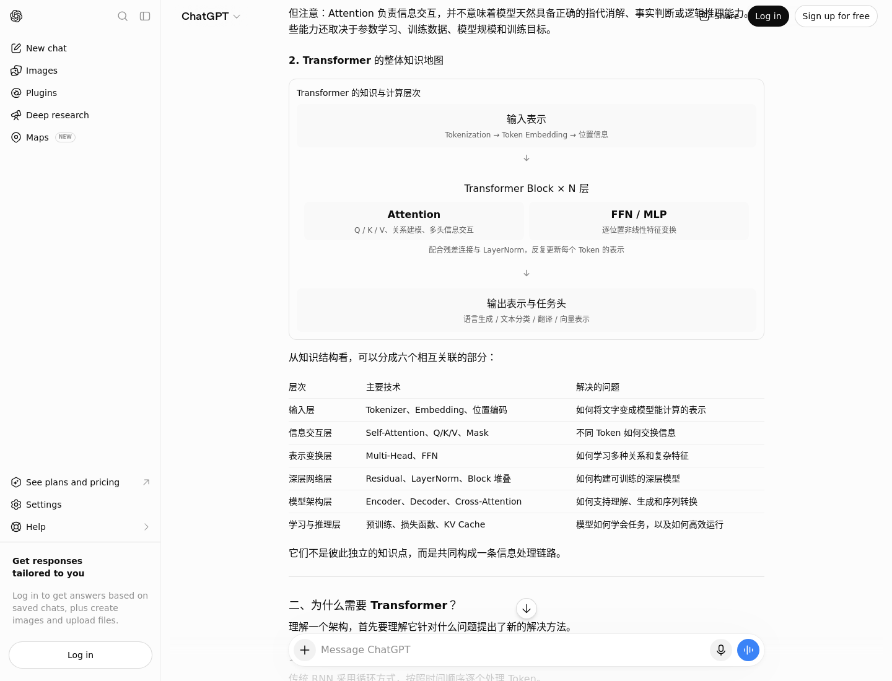
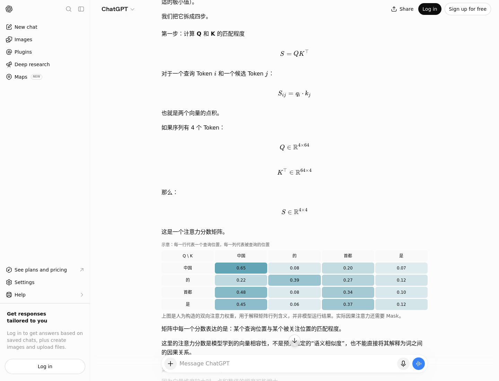
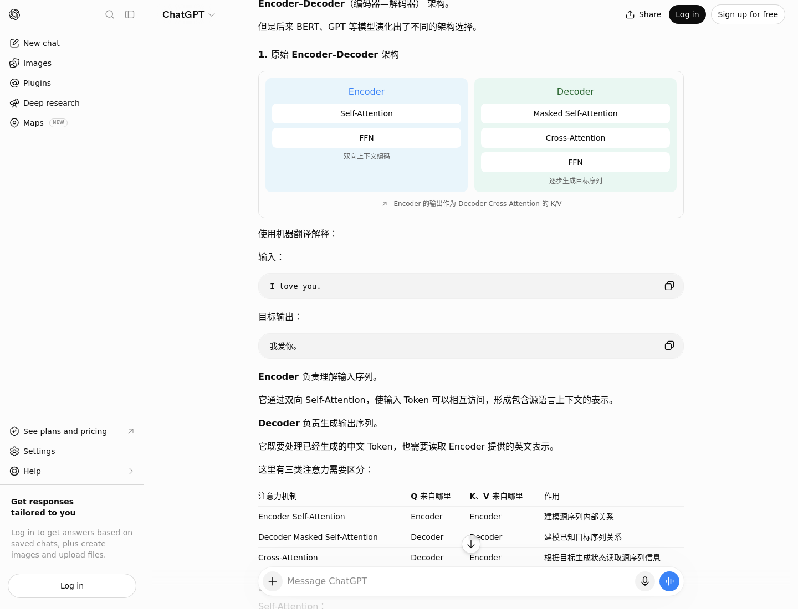
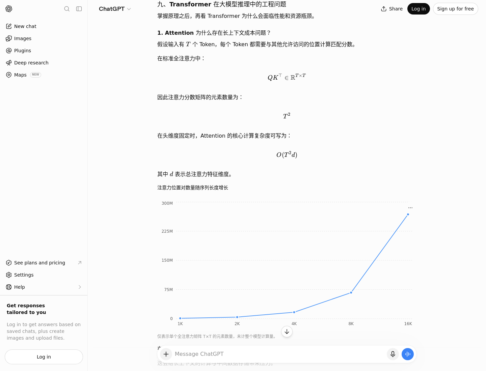

# ChatGPT Chat 模式 · 真实对话展示

**一句“lr 系统讲解 transformer”，从知识主干走到机制、数学和工程。**

这是作者提供并授权公开展示的真实 ChatGPT 共享会话。截图直接来自共享页面，保留 ChatGPT 的实际排版、数学表达、图示与图表。

**[打开原始会话 / Open in ChatGPT](https://chatgpt.com/share/6ad6bc80-00d0-83e8-a6c7-f83d75adaf68)** · **[完整页面长图 / Full-page capture](../docs/assets/chatgpt-transformer/full.png)** · [截图来源与复现](../docs/presentation.md)

## 从自然提问开始

原始输入：`lr 系统讲解 transformer`

先说明要理解哪些问题，再进入主要组成和信息流。这个公开页面包含一次用户提问和一次完整回答。

## 建立整体知识架构

输入表示、Attention、FFN、残差与归一化、输出任务之间的联系，先在一张图中建立，再用表格对应各层解决的问题。

## 把机制落到数学与数值

Q/K 的矩阵维度、点积和权重矩阵放在同一段解释中。原回答明确标出了矩阵中的权重是教学构造值，帮助区分演示与模型实测。

## 连接模块与完整架构

Encoder 与 Decoder 的图示把模块职责放回信息流中，随后解释 Cross-Attention、架构差异与实际用途。

## 从原理走到工程代价

长上下文部分用曲线展示注意力矩阵元素数量随序列长度增长的关系，并明确其统计口径。图表与公式共同解释工程代价，随后衔接 KV Cache 等推理问题。

## 完整页面

长图为 **1440 × 29467** 像素，保留从原始问题到回答结尾的全部显示内容。点击图片链接可查看原尺寸；完整阅读也可以直接打开上方共享会话。

**[打开完整页面长图](../docs/assets/chatgpt-transformer/full.png)**

展开完整长图 / Expand the complete capture

图示、数学与图表的静态呈现已实际截取；此案例没有验证参数调节类交互，也没有追加或编造后续追问。公开页面未标明原始模型与技能版本，来源记录见 [capture.json](../docs/assets/chatgpt-transformer/capture.json)。

若要进一步探索机制，可以在自己的可用环境中继续追问：“展开 Multi-Head Attention 的张量形状变化”或“如果界面支持，用可调分数演示 Softmax”。这些是使用建议，不属于上面已截图的原始会话。

[English project introduction](../README.md) · [中文项目介绍](../README.zh-CN.md) · [独立的 CLI 测试案例与完整记录](cli.md) · [受控评估报告](../evals/REPORT.md)
