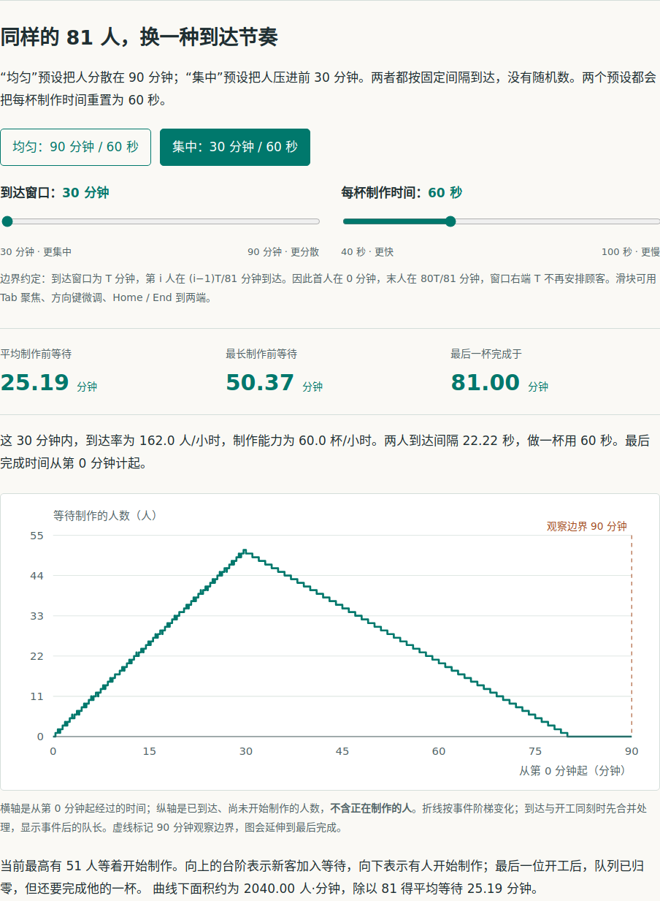

# 从队列机制到可讨论的方案

**[打开完整展示页](https://aikuozone.github.io/lucid-reason/)** · [亲手操作实验](https://aikuozone.github.io/lucid-reason/demos/queue-lab/) · [完整三轮对话](conversation.md) · [浏览器操作录屏](../../docs/assets/queue-lab/walkthrough.webm)

问题由维护方自行设计，门店与数据均为教学设定。lr 在同一个原生 Codex 会话中实际回答三轮，并在第一轮生成完整的单文件交互讲解。没有使用其他案例的截图、对话或图表。

## 1. 平均够快，为什么仍然排队

同样 81 位顾客、每杯 60 秒：分散在 90 分钟到达时，理想模型中的制作前等待为零；集中在前 30 分钟到达时，平均等待约 25.19 分钟，最长约 50.37 分钟。图、公式、逐人记录和两个滑块让读者能复核原因。

[原始生成 HTML](../../docs/demos/queue-lab/index.html)可以下载后直接离线打开。未对模型生成的页面做编辑修改。

## 2. 让初案成为继续讨论的基础

| 轮次 | 提问重点 | 回答中可观察到的变化 |
|---|---|---|
| 1 | 解释排队，并给完整改善初案 | 区分平均值与瞬时积压，连接全流程和局部模型，提出测量、分流、制作改善与验证。 |
| 2 | 两周内不加人、不增购、不影响营业；想做手机预约 | 区分预下单、容量排程与完成通知，检查全流程影响；先做轻量观察、交接试验与预约影子演练。 |
| 3 | 不排除不用手机的顾客，不以转移等待冒充变快 | 补齐线下服务、时间口径、公平与异常，保留人员期限约束，整合当前方案和待实测假设。 |

阅读[三轮完整输入和回答](conversation.md)。展示页摘要属于编辑整理；引用逐字对应原回答。临时文件链接在可读转录中指向仓库内对应页面，原始 JSON 保留模型输出原文。

## 素材与验证

| 文件 | 用途 |
|---|---|
| [preview.png](../../docs/assets/queue-lab/preview.png) | README 使用的实际页面裁剪，突出控件、指标和曲线。 |
| [desktop.png](../../docs/assets/queue-lab/desktop.png) / [mobile.png](../../docs/assets/queue-lab/mobile.png) | 同一交互讲解区域在桌面、手机的真实截图。 |
| [完整桌面页面](../../docs/assets/queue-lab/full-desktop.png) / [完整手机页面](../../docs/assets/queue-lab/full-mobile.png) | 保留整篇实际生成的图文讲解。 |
| [walkthrough.webm](../../docs/assets/queue-lab/walkthrough.webm) | 实际操作预设、键盘调参，再阅读三轮方案摘要的连续浏览器录屏。 |
| [capture.json](../../docs/assets/queue-lab/capture.json) | 3,721 组整数参数、301,401 条顾客记录、非法输入、图形面积、页面交互与截图哈希。 |
| [scenario.json](source/scenario.json) / [运行环境](source/run/environment.json) / [原始运行结果](source/run/queue-lab-lr-r1.json) / [来源记录](source/provenance.json) | 完整输入、回答、生成页面、技能哈希和版本信息。 |

实际运行：lr **1.1.5**，Codex CLI **0.160.0**，**gpt-6.1-sol / medium**。第一轮显式调用技能，后两轮恢复同一原生会话。没有无技能对照，也没有真实门店经营试验。本例展示使用过程，不作为通用提升结论或 ChatGPT 原生组件渲染的证明。

复现步骤见[展示来源说明](../../docs/presentation.md)。
